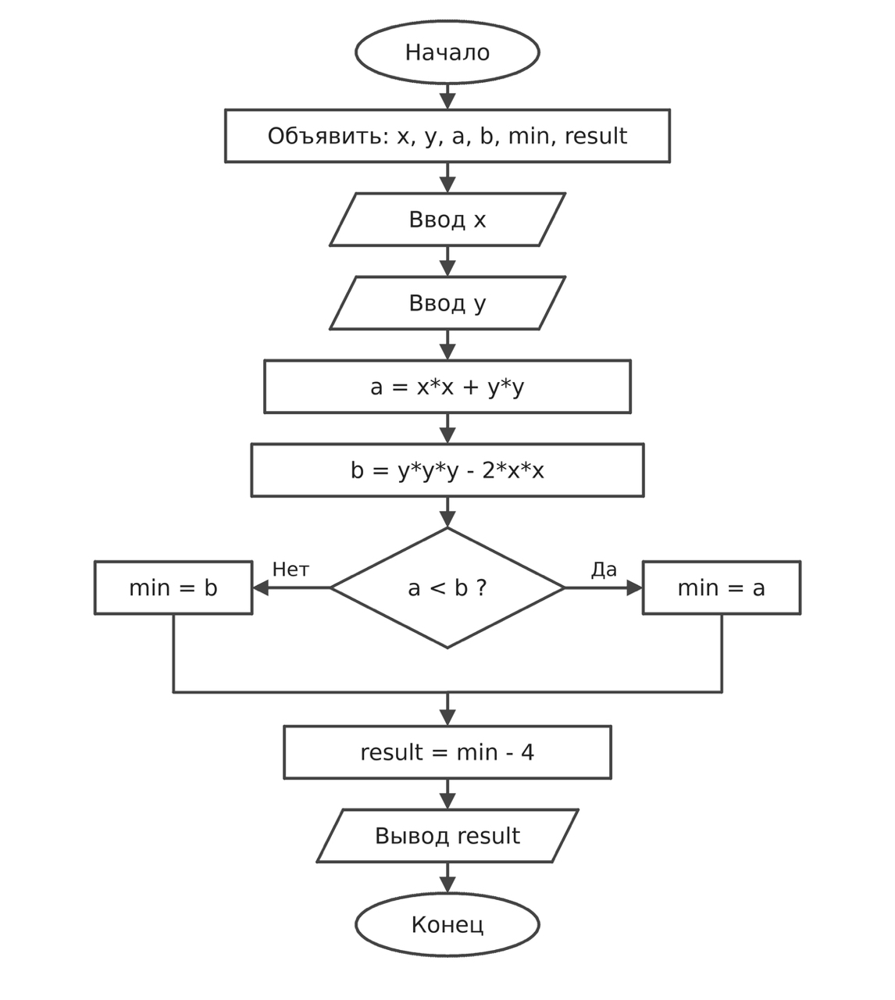

# Домашнее задание к работе 6
## Условие задачи:
Вариант 1. Calculate min(x²+y², y³-2*x²)-4, where x, y – input variable.
## 1. Алгоритм и блок-схема
1. Начало
2. Объявить переменные: x, y (входные значения, вещественные), a, b (промежуточные значения, вещественные), min (меньшее из a и b, вещественное), result (результат, вещественное)
3. Ввести значение x
4. Ввести значение y
5. Вычислить первое значение: a = x*x + y*y
6. Вычислить второе значение: b = y*y*y - 2*x*x
7. Проверка условия: a < b ?

   • Если «Да» (условие истинно): перейти к шагу 8.

   • Если «Нет» (условие ложно): перейти к шагу 9.

8. Присвоить: min = a. Перейти к шагу 10
9. Присвоить: min = b
10. Вычислить результат: result = min - 4
11. Вывести значение result
12. Конец
## Блок-схема

## 2. Реализация программы
```c
#define _CRT_SECURE_NO_WARNINGS
#include <stdio.h>
#include <locale.h>

int main() {
    setlocale(LC_ALL, ".UTF-8");

    double x, y, a, b, min, result;

    printf("Введите значение x: ");
    scanf("%lf", &x);
    printf("Введите значение y: ");
    scanf("%lf", &y);

    a = x * x + y * y;
    b = y^3 - 2 * x^2;

    if (a < b) {
        min = a;
    }
    else {
        min = b;
    }

    result = min - 4;

    printf("Результат: %lf\n", result);

    return 0;
}
```
## 3. Результат работы программы
Введите значение x: 2

Введите значение y: 3

Результат: 9,000000
## 4. Информация о разработчике:
Баженова Валерия Андреевна 6ТИИ-261 1 ПОДГРУППА
